# ![[tktk Postman Setup Lab] - Exercise](./assets/hero.png)

Welcome to the Postman Setup lab. In this lab, we will guide you through installing and using Postman for the first time. In the response and request cycle, a client sends a request and processes responses from a server. While we've previously explored the browser as a client, it's important to note that various clients can make requests to a server. Some of these clients are:

- [cURL](https://curl.se/)
- [JMeter](https://jmeter.apache.org/)
- [Insomnia](https://insomnia.rest/)
- [Swagger](https://swagger.io/)
- [Postman](https://www.postman.com/)

Let's take a look at where Postman fits into the client-server relationship.

- tktk Hunter - I like the below image from the postman docs however it does look like there might be 2 postman; one sending a request and one recieving the response. I'm not sure if that would be confusing to students but if we could take the same idea and make there only be one postman doing both actions. Can we use `https://jsonplaceholder.typicode.com/posts` as the URL replacement. 

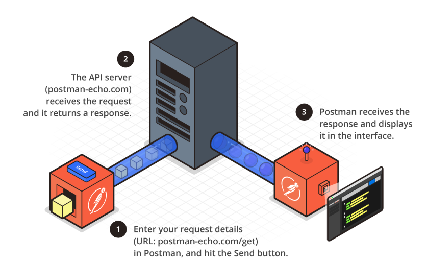

Postman is a tool that allows us to make requests to an API and process the response. Above, we can see that without a browser or code, we can:

1. Make a request to `https://jsonplaceholder.typicode.com/posts`.
2. The JSONPlaceholder API server will receive the request and send a response back to Postman.
3. Postman will display the response using its built-in interface.

Postman opens a world of possibilities for us as developers:

- **API Requests** - Enables us to make `GET` `POST`, `PUT`, `PATCH`, and `DELETE` requests. Additionally, we can include headers, query parameters, and request bodies in our API requests.
- **Collections** - Organize our requests into a folder-like structure called collections. This makes it easy to find and reuse requests.
- **Environments** - Create and store environment variables. This can include things like API keys and root URLs.
- **Tests** - JavaScript tests can be written to validate the response from an API request.
- **Documentation** - Allows us to automatically create documentation for our APIs.
- **Monitoring** - Can monitor the performance of our APIs.
- **Mock Servers** - Can create mock servers to simulate an API response.
- **Collaboration** - Allows an almost GitHub-like experience for collaborating on APIs, including version control.
- **Integration** - Integrates with other tools and services.

Simply said, Postman is a powerful tool that allows developers a lot of flexibility when working with APIs. In this module, we will focus on some of Postman's basics. We will explore the interface, make requests, and save requests.

## Download and Install Postman

We will be using the desktop version of Postman for class. Navigate to the [Postman downloads](https://www.postman.com/downloads/) page. Once on the page, Postman will automatically detect your operating system and provide you with the correct download link. Click the download button to begin the download.

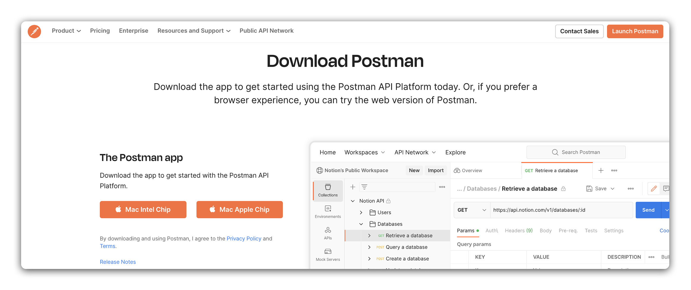

If you are using a Mac, you will be prompted to drag the Postman icon into your Applications folder. You will be prompted to run the installer if you are using Windows. Follow the prompts to complete the installation.

> Unsure of what chip your Mac is using? You can find out by clicking the Apple icon in the top left corner of your screen and selecting **About This Mac**. You will see **Apple** listed under **Chip** if you have an Apple chip. The **Apple** will be followed by the chip type, such as **M1**. You will see **Intel** listed under **Chip** if you have an Intel chip.

## Create a Postman Account

You have the option to create an account with Postman. This is not required to use Postman, but it does offer some options that might be useful in the future:

- **Sync** - Allows us to sync our Postman data across devices.
- **Team** - Allows us to collaborate with others on Postman in a GitHub-like fashion.

Sign up for a Postman account [here](https://www.postman.com/postman-account/). Click the `Sign Up` button.

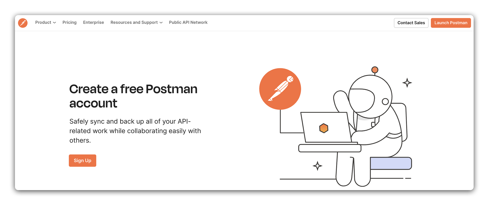

You can use your Google account or, enter your email address, and create a password. Click the `Sign Up` button.

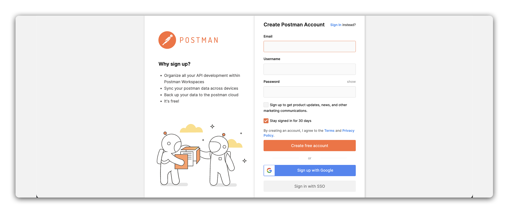

Once you have signed up, you will be taken to the Postman dashboard. Open your desktop Postman application. Located in the upper right corner, click on the `Sign In` button.

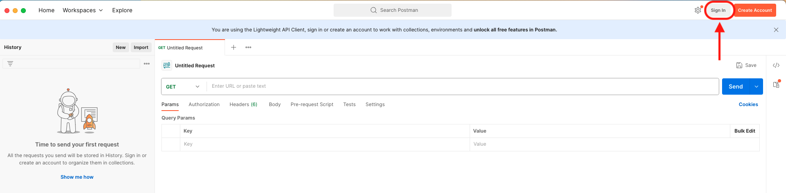

Postman will display a window saying `Sign in from your browser to continue`.

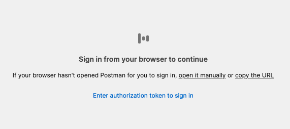

Follow the steps in the browser to sign in to the account you just created. Once you have signed in, you will be returned to the Postman application.

## Postman Interface Overview

Let's visit our Workspace in Postman. The Workspace is where we will spend most of our time in Postman. It is where we will make requests, save them, and organize them into collections. Open the Postman application, click the **Workspace** tab, and select **My Workspace**.

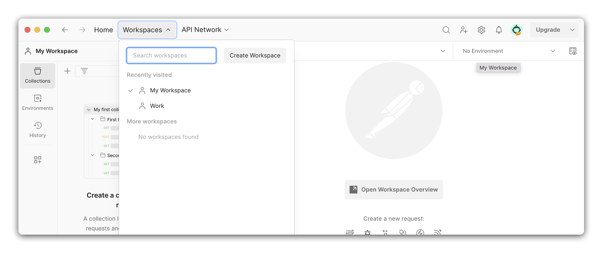

Once in the Workspace, we will see the following:

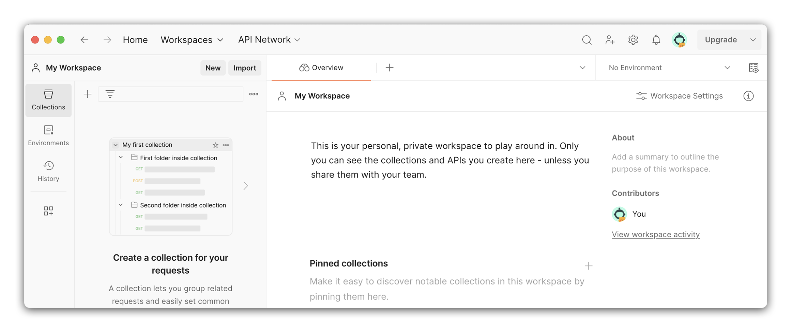

Let's take a look at the different sections of the Workspace. By clicking on the left sidebar, we can toggle the visibility of the different sections and open and close the sidebar itself. 

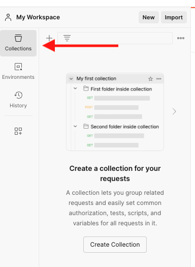

**Collections** are a way to organize our requests. This is a folder-like structure where the request can be grouped together like files in a folder. 

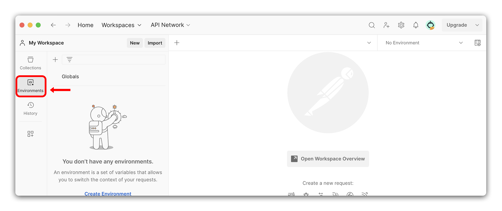

**Environments** are a way to store variables. This acts like a `.env` file. We can store things like API keys, but we can also store root URLs here. This allows us to easily switch between environments. For example, we can have a development environment and a production environment. We can store the root URL for each environment in the environments and easily switch between the two.

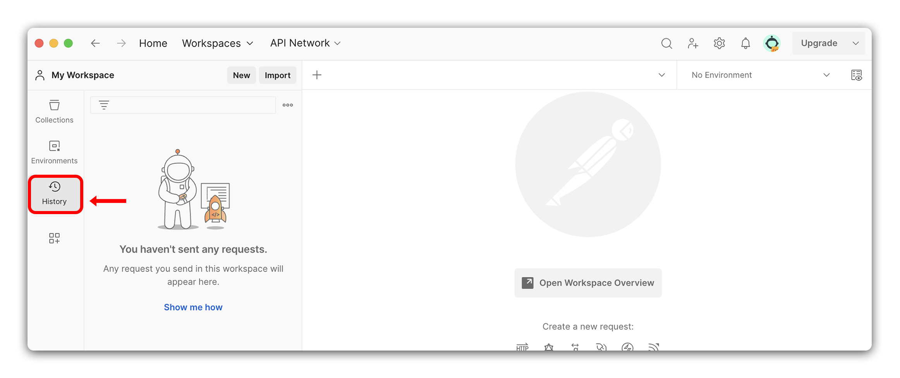

**History** is a list of the requests we have made. This is a great way to quickly find a request we have made in the past.

## Make a GET Request

We will make a `GET` request to the [JSONPlaceholder API](https://jsonplaceholder.typicode.com/). This API is an API that returns fake data. This is a great API to use when learning how to make requests to an API. We will be making a request to the [posts](https://jsonplaceholder.typicode.com/posts) endpoint. This endpoint will return a list of posts.

To make a new request, make sure your left sidebar is open by clicking on any of the icons located on the left-hand side. Once the left sidebar is open, click the `New` button.

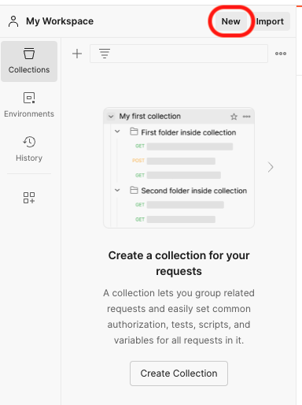

This will open a window where we can select what new action we want to create. Select `HTTP` from the list.

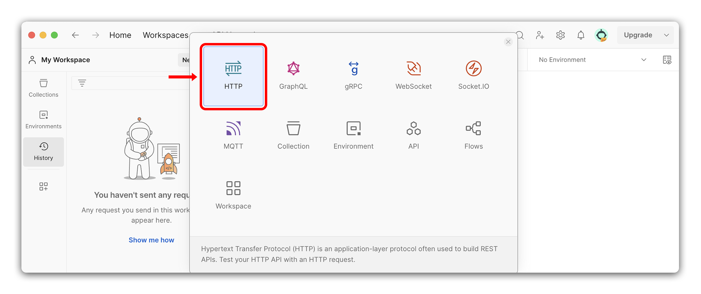

This will open a new request tab in Postman. Let's walk through the different parts of the request interface.

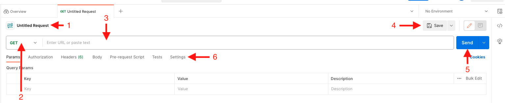

1. **Request Name** - Name of the request. Requests can be renamed when saving the request. Requests can be named anything we want. This is a great way to keep track of what the request is doing. For example, we can name this request `Get Posts`.
2. **Request Method** - A drop-down menu of the requests we can make. The default is `GET`. We can change the request method by clicking on the drop-down menu and selecting a different request method.
3. **Request URL** - The URL of the request. This is where we will enter the URL we want to make a request to.
4. **Save** - This button saves the current request for later use.
5. **Send** - The button we will click to send the request. This will send the request to the URL we have entered in the request URL input box.
6. **Options** - We can add items to our request, such as authorization, headers, query parameters, and a body.

Let's make a `GET` request to the [posts](https://jsonplaceholder.typicode.com/posts) endpoint. Enter `https://jsonplaceholder.typicode.com/posts` into the request URL input box. Click the `Send` button.

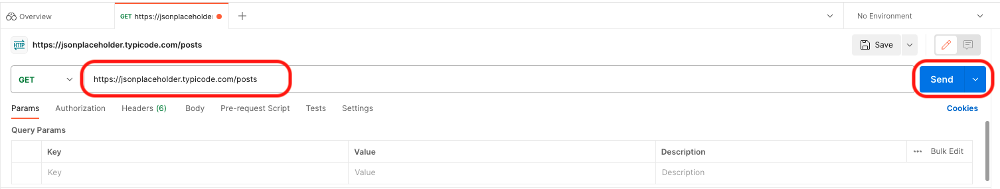

In the bottom part of the interface, we can see the response from the API. Let's dive into the different parts of the response.

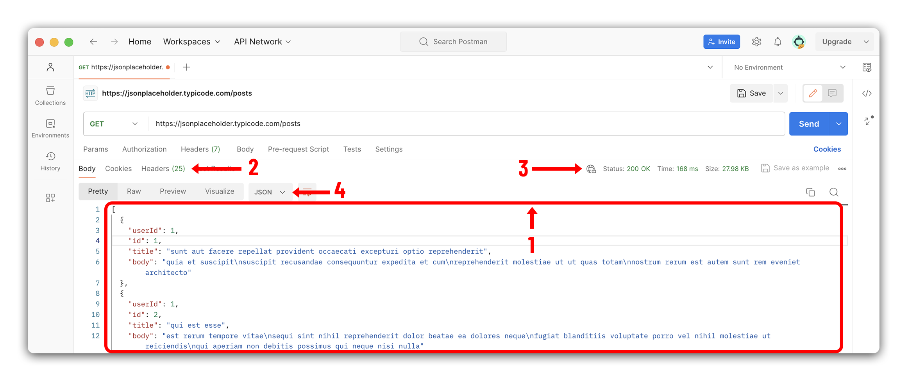

1. **Body** - The body of the response. This is where we will see the data returned from the API.
2. **Headers** - The headers of the response. This is where we will see the headers returned from the API.
3. **Status** - The status of the response. This is where we will see the status code returned from the API.
4. **Viewing Options** - These are the different ways to view the response. We can view the response as `Pretty`, `Raw`, `Preview`, and `Visualize`.

That's it! We successfully made a `GET` request to an API using Postman.

## Save a Request

Now that we have made a request let's save it. Saving a request allows us to access the request easily later. It also allows us to organize our requests into collections. Let's save the request we just made.

Looking at the tab, we can easily see if a request is unsaved. If there is a little orange dot next to the request name, the request is unsaved. 

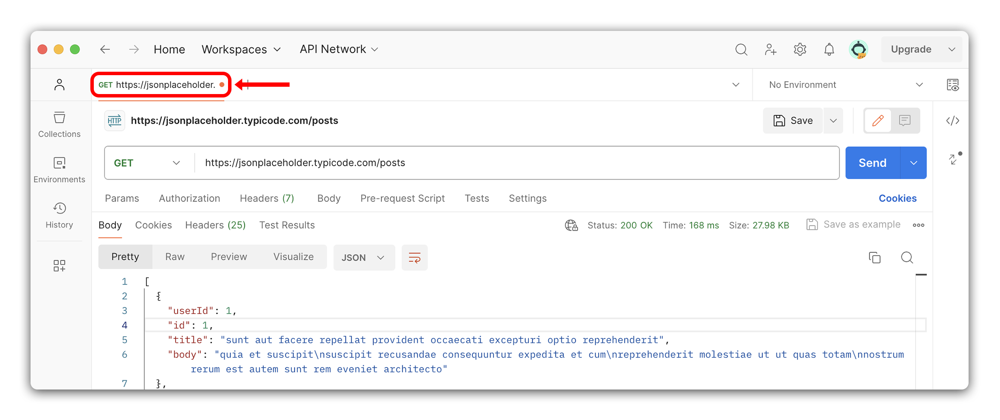

To save a request, click on the `Save` button on the right side. 

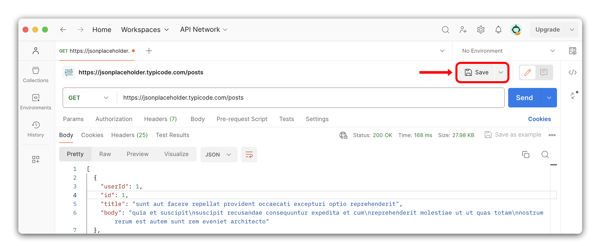

A window will pop up asking us to name the request and provide a collection name. Let's name the request `Get Posts` and create a new collection called `JSONPlaceholder API`.

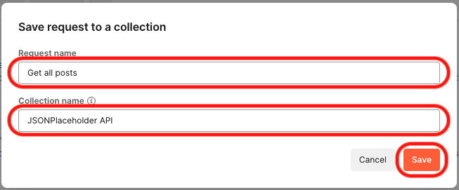

Click the `Save` button. The request is now saved. We can see this by looking at the tab. The orange dot is gone, and the request name is now `Get Posts`. We can also see in our `Collections` section on the left-hand side, there is a new collection called `JSONPlaceholder API`. If we click on the collection, we will see our request.

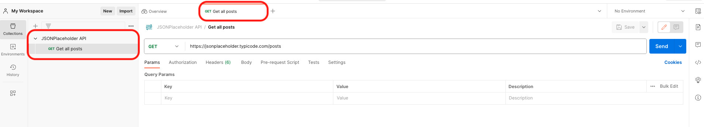

Congrats, you have successfully made your first request and saved it! 🎉